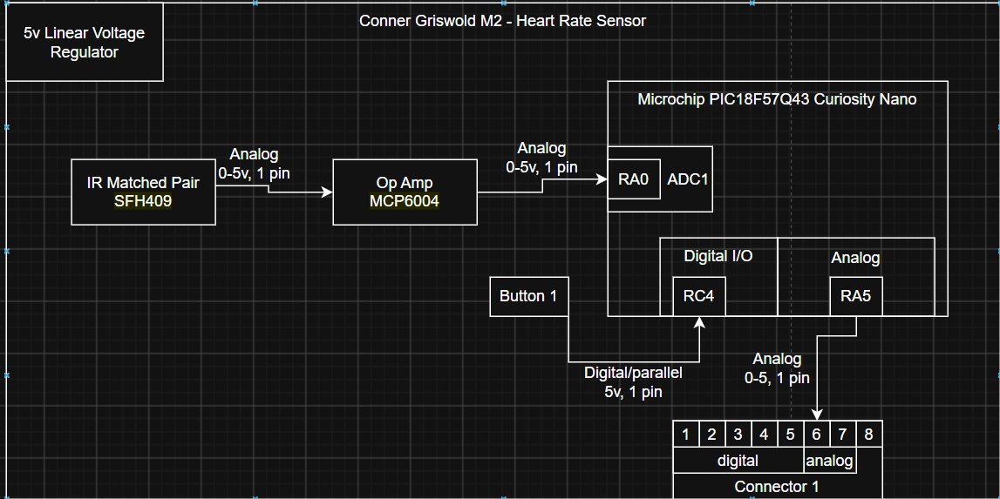

---
## Overview
The heart rate sensor uses photoplethysmography (PPG) to detect changes in blood flow. An infrared (IR) LED emits light into the skin, while a photodiode measures the amount of light reflected back (The IR matched Pair). As blood volume changes with each heartbeat, the reflected light intensity varies, producing a small analog signal related to the pulse.
The photodiode signal is amplified and filtered by the MCP6004 opamp to improve signal quality and increase the voltage level to a range good for processing. The conditioned analog signal is then sampled by the PIC18F57Q43 microcontroller through its analog to digital converter (ADC), where it cleans and pushes out a more refined analog to team members.
---

## Block Diagram 

