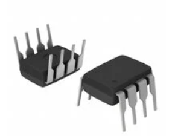
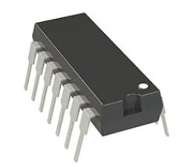
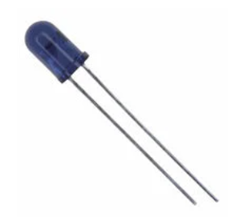
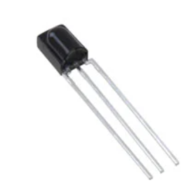
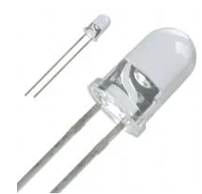
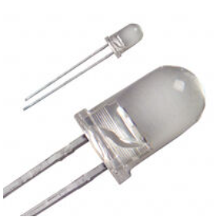
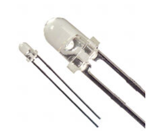
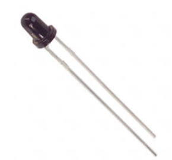
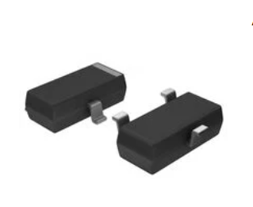
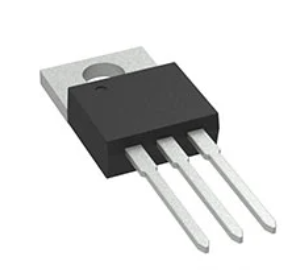

**Input Op amp**

1. ### CA3140AEZ MOSFET‑input op amp

    

    * $3.78/each
    * [link to product](https://www.digikey.com/en/products/detail/renesas-electronics-corporation/CA3140AEZ/821386)

    | Pros                                      | Cons                                                             |
    | ----------------------------------------- | ---------------------------------------------------------------- |
    | Very high input impedance ideal for weak heart‑rate sensor signals                           | Not rail‑to‑rail limits output swing in low voltage designs |
    | Wide supply range (4 V–36 V)                      |Older design with limited availability                                        |
    | Low offset voltage stable baseline for pulse detection| Requires external biasing and filtering|

2. ### MCP6004-I/P Low-Power Quad Rail-to-Rail Op Amp

* ~$0.60/each
* [Link to product](https://www.digikey.com/en/products/detail/microchip-technology/MCP6004-I-P/523060)

| Pros | Cons |
|--------|--------|
| Rail-to-rail input and output maximizes signal range on 3.3 V and 5 V systems | Lower bandwidth (1 MHz) than many high-speed op-amps |
| Very low power consumption (100 µA typical per amplifier) | Not ideal for high-frequency or RF applications |
| Includes four op-amps in one package, reducing PCB space and cost | Moderate input offset voltage (4.5 mV typical) |
| Operates from 1.8 V to 6 V, making it ideal for battery-powered sensor circuits | Limited slew rate (0.6 V/µs) for fast-changing signals |
| Extremely low input bias current (1 pA typical) works well with photodiodes and sensor interfaces | |

 
3. ### TL081CP JFET‑input op amp

    

    * $0.65/each
    * [link to product](https://www.digikey.com/en/products/detail/texas-instruments/TL081CP/458)

    | Pros                                      | Cons                                                             |
    | ----------------------------------------- | ---------------------------------------------------------------- |
    | JFET‑input like CA3140 excellent for high impedance heart‑rate sensors | Requires dual supply for full performance in some configurations |
    | High slew rate (13 V/µs) preserves pulse waveform shape               | Not rail to rail reduced output swing at low voltages           |
    | Through‑hole DIP‑8 easy prototyping and breadboard‑friendly           | Slightly higher input bias current than CA3140                   |

### Why the MCP6004 is the best op‑amp choice
The MCP6004 is a good op amp because it is low-power, rail-to-rail, and works with 3.3 V or 5 V supplies. It also includes four op amps in one chip, making it a compact and cost-effective choice for sensor and microcontroller projects like a heart rate monitor.

   **IR TX and RX Pair**

   
1. ### TSAL6200 (IR Transmitter) + TSOP38238 (IR Receiver)

    
    

    * TX: $0.72/each — TSAL6200
    * RX: $1.18/each — TSOP38238
    * [link to TX](https://www.digikey.com/en/products/detail/vishay-semiconductor-opto-division/TSAL6200/1681339)
    * [link to RX](https://www.digikey.com/en/products/detail/vishay-semiconductor-opto-division/TSOP38238/1025779)

    | Pros                                      | Cons                                                             |
    | ----------------------------------------- | ---------------------------------------------------------------- |
    | Very strong IR output excellent for reflective heart‑rate sensing | Requires 38 kHz modulation for proper RX operation |
    | Through‑hole easy to mount and prototype | RX has narrow detection bandwidth |
    | High sensitivity receiver reduces noise in pulse detection | TX requires current‑limiting resistor |
   

3. ### SFH4550 (IR Transmitter) + SFH213 (IR Photodiode)

    
    

    * TX: $0.48/each — SFH4550
    * RX: $0.62/each — SFH213
    * [link to TX](https://www.digikey.com/en/products/detail/osram-opto-semiconductors-inc/SFH4550/720473)
    * [link to RX](https://www.digikey.com/en/products/detail/ams-osram-ag/SFH-213/607286)

    | Pros                                      | Cons                                                             |
    | ----------------------------------------- | ---------------------------------------------------------------- |
    | Photodiode RX allows analog signal extraction ideal for heart‑rate waveform | Requires external amplifier (op‑amp stage) |
    | Wide‑angle IR LED improves skin illumination | More sensitive to ambient light than demodulated receivers |
    | Very inexpensive pair                      | Requires careful PCB layout for noise reduction |

5. ### LTE‑4208 (IR LED) + LTR‑4206E (IR Phototransistor)

    
    
    * TX: $0.38/each — LTE‑4208
    * RX: $0.52/each — LTR‑4206E
    * [link to TX](https://www.digikey.com/en/products/detail/liteon/LTE-4208/121707)
    * [link to RX](https://www.digikey.com/en/products/detail/liteon/LTR-4206E/121710)

    | Pros                                      | Cons                                                             |
    | ----------------------------------------- | ---------------------------------------------------------------- |
    | Matched LED + phototransistor pair ideal for reflective heart‑rate sensing | Phototransistor slower response than photodiode |
    | Through‑hole DIP package easy to mount and prototype | More sensitive to ambient IR interference |
    | Good sensitivity for low cost PPG setups | Requires external biasing and filtering circuitry |

### Why the SFH4550 + SFH213 pair is the best IR choice
The SFH4550 + SFH213 pair is ideal for a DIY heart rate sensor because it gives you a true analog photoplethysmography signal rather than a digital IR presence output. The SFH4550’s wide angle IR emission illuminates the skin evenly while the SFH213 photodiode produces a fast, linear current response that captures subtle blood‑volume changes accurately. Both parts are through hole, easy to mount on a custom PCB, and work perfectly with a transimpedance amplifier like the CA3140. This combination yields a clean, responsive waveform that can be filtered and amplified without fighting the limitations of slower phototransistors or demodulated IR receivers.

### AO3400A N-Channel MOSFET

* $0.18/each
* [link to product](https://www.digikey.com/en/products/detail/alpha-omega-semiconductor-inc/AO3400A/1855786)

| Pros | Cons |
| ------ | ------ |
| Logic-level operation works from 3.3 V and 5 V GPIO pins | Small SOT-23 package can be difficult to hand-solder |
| Very low RDS(on) for efficient switching | Limited power dissipation compared to larger MOSFETs |
| Compact footprint ideal for custom PCB designs | Not suitable for high-power loads without thermal considerations |

### 2N7002 N-Channel MOSFET

* $0.10/each
* [link to product](https://www.digikey.com/en/products/detail/onsemi/2N7002LT1G/918072)

| Pros | Cons |
| ------ | ------ |
| Inexpensive and widely available | Higher RDS(on) than modern power MOSFETs |
| Suitable for logic-level switching applications | Limited current handling capability |
| Excellent for signal switching and low-power control circuits | Not ideal for driving high-current LEDs or motors |

### LM7805 Fixed Output Linear Regulator

* $0.72/each
* [link to product](https://www.digikey.com/en/products/detail/stmicroelectronics/L7805CV/585964)

| Pros | Cons |
| ------ | ------ |
| Provides a stable regulated 5 V output | Excess input voltage is dissipated as heat |
| Simple implementation requiring only a few external capacitors | Requires input voltage above approximately 7 V |
| Includes built-in thermal and short-circuit protection | Less efficient than switching regulators |
| Well suited for powering op amps, microcontrollers, and sensors | May require a heatsink at higher load currents |

#### Why the LM7805 Was Selected
The LM7805 was chosen because it provides a simple, reliable, and stable 5 V power supply for the heart-rate sensor circuit. It can regulate a higher input voltage down to a clean 5 V output required by the CA3140AEZ op amp, IR LED, photodiode interface circuitry, and microcontroller. Unlike switching regulators, the LM7805 produces very low electrical noise, which is important when amplifying the extremely small signals generated by the photodiode. Its built-in thermal shutdown and current limiting also improve circuit safety and reliability, making it an excellent choice for a low-power biomedical sensing application.
