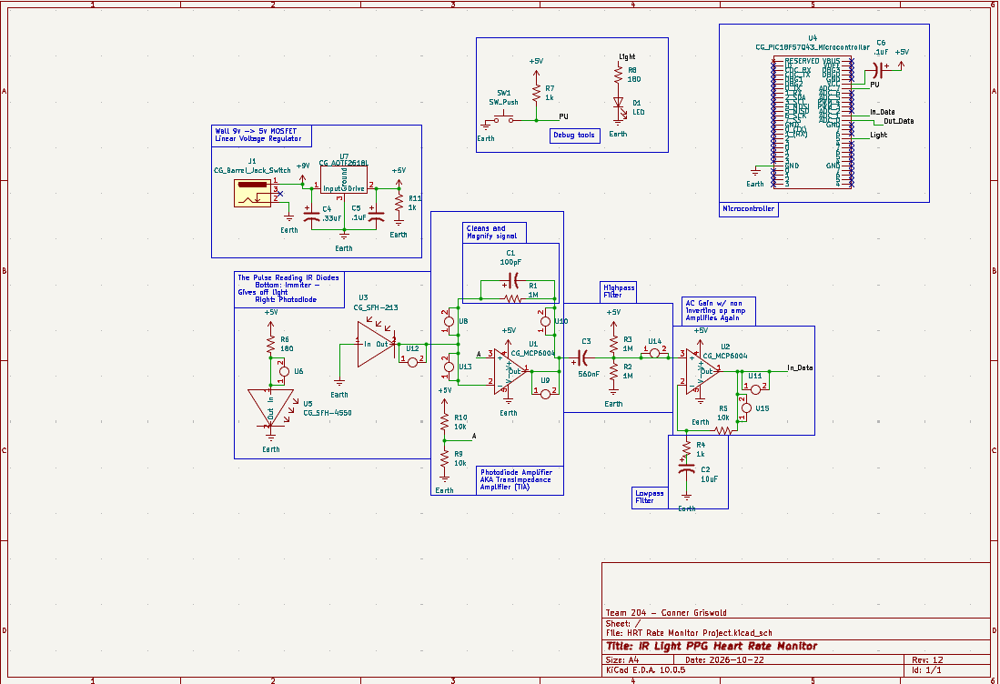
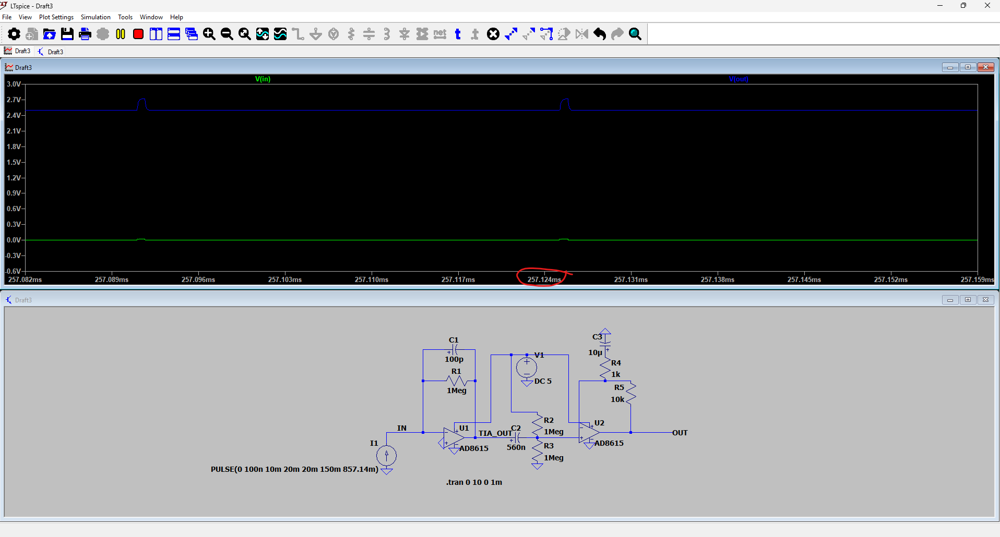
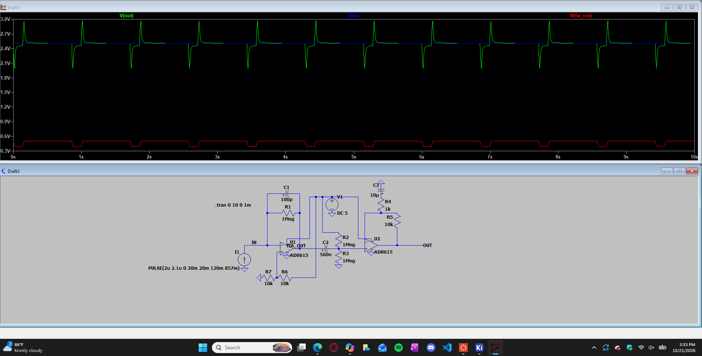
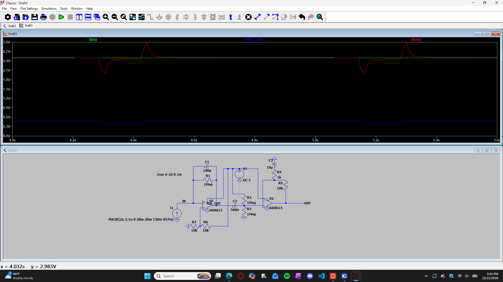
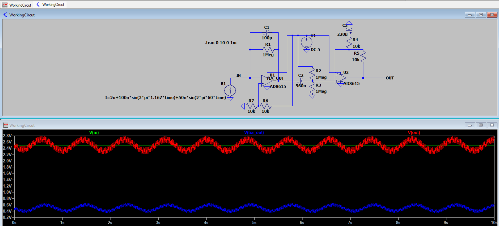

## Overview

**1. IR Emitter and Photodiode — Detecting the Heartbeat**

The IR emitter (U5 CG_SFH-4550) shines infrared light into the tissue and the photodiode (U3 CG_SFH-213) detects the returning light. Changes in blood volume caused by each heartbeat change the amount of reflected light. The photodiode converts these light changes into a small electrical current. This produces the original input signal which contains the heartbeat and noise.

**2. Photodiode Amplifier (TIA) — Converting Current to Voltage**

The first op-amp (U1 CG_MCP6004) converts the photodiode's small current into a measurable voltage using the feedback resistor (R1 1Mohms). The formula used is the transimpedance relationship which relates output voltage to input current and feedback resistance. The current comes from the photodiode and the resistance comes from the TIA feedback path. This stage produces a voltage signal containing the heartbeat information.

**3. Highpass Filter — Removing Slow Changes**

The high-pass filter reduces slow changes in the sensor signal while allowing faster heartbeat variations to pass. The formula used is the RC highpass cutoff frequency formula which uses the resistance (R2 1Mohms) and capacitance (C3 560nF) shown in the filter section. The cutoff frequency determines which signal frequencies are attenuated and which pass through more easily. Also note that this stage acts as a DC bias.

**4. AC Gain Stage — Amplifying the Heartbeat**

The second op-amp (U2 CG_MCP6004) increases the size of the heartbeat signal so it can be measured more reliably. The formula used is the noninverting opamp voltage gain formula which uses the feedback resistor (R5 10kohms).This stage increases the AC signal amplitude.

**5. Lowpass Filter — Removing Fast Noise**

The lowpass filter reduces high frequency noise while allowing the slower heartbeat waveform to pass. The formula used is the RC lowpass cutoff frequency formula which uses the resistor (R4 1kohms) and capacitor (C2 10uF) shown in the filter section. The cutoff frequency determines how strongly higher frequency components are attenuated.

**6. Microcontroller — Receiving and Transmiting Heart Rate**

The PIC18F57Q43 microcontroller reads the processed signal through the "In_Data" input and converts the analog voltage into a digital value using its analog to digital converter (ADC). Then pushing it back out to "Out_Data" for the next microcontroller.

**7. Overall Signal Flow**

The circuit converts changes in reflected infrared light into an electrical signal that can be analyzed. The photodiode detects the light changes, the TIA converts current into voltage, the highpass filter reduces slow variations, the gain stage amplifies the heartbeat, and the lowpass filter reduces rapid noise. Finally, the microcontroller samples the signal and pushes out the signal to another microcontroller.

## LTspice Testing
To ensure the chosen circuit design would work I built the same circuit in LTspice to experiment with values and circuit types. Below is the testing of the circut with different current source values and the output it gives.
Test 1. 

Test 2. 

Test 2.1. 

Test 3. 

## Resouces

The schematic as a PDF download is available [*here*](HRTRateMonitorProject-10_27.pdf), and the Zip folder of the project [*here*](HRTRateMonitorProject-10_19.zip).
