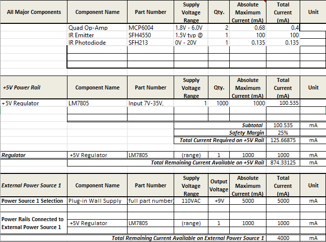

## Overview
The power budget is set out to solve the issue of power planning. With a demand for power this solves who gets what power voltage and what the total draw of amps will be. By doing this we can find out if the demand for power is greater then the supply and thus pivot to another source or multiple source 

{style width:"350" height:"300;"}
## Conclusions
The total demand for power will be sufficiently below the power supply meaning that there should be little to no problems with power draw
<!--## ResoucesThe power budget as a PDF download is available [*here*](PowerBudgetExample.pdf), and a Microsoft Excel Sheet [*here*](PowerBudgetExample.xlsx).-->
